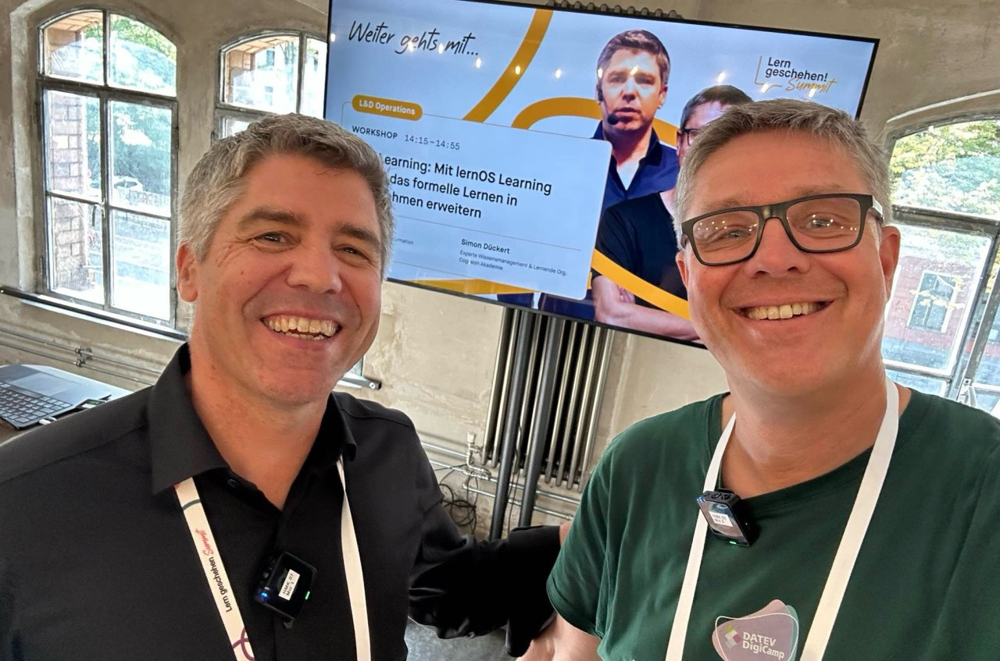

---
date:
  created: 2026-10-14
draft: false
pin: false
categories:
  - lernos
  - Workshop
  - Berlin
  - PeerLearning
---

# Aufzeichnung des Workshops zu Peer Learning mit lernOS auf dem Lern geschehen! Summit

Am 14. Oktober 2026 haben [Christian](https://www.linkedin.com/in/christian-kaiser-datev) und [Simon](https://www.linkedin.com/in/simondueckert) einen Workshop mit dem Titel **"Peer Learning: Mit lernOS Learning Circles das formelle Lernen in Unternehmen erweitern"** auf dem Lern geschehen! Summit von Masterplan in Berlin gehalten. Folien und Aufzeichnung der Tonspur stellen wir hier im Blog bereit.

<!-- more -->

Links:

- [Folien zum Workshop](https://cloud.cogneon.de/s/LgT4ZREFB9igLze) (PDF)
- [Folge des lernOS on Air Podcast](https://podcasts.cogneon.io/@loa/episodes/peer-learning-workshop-auf-dem-lern-geschehen-summit-von-masterplan-in-berlin) mit der Aufzeichnung der Tonspur des Workshops (nur Christian/Simon)